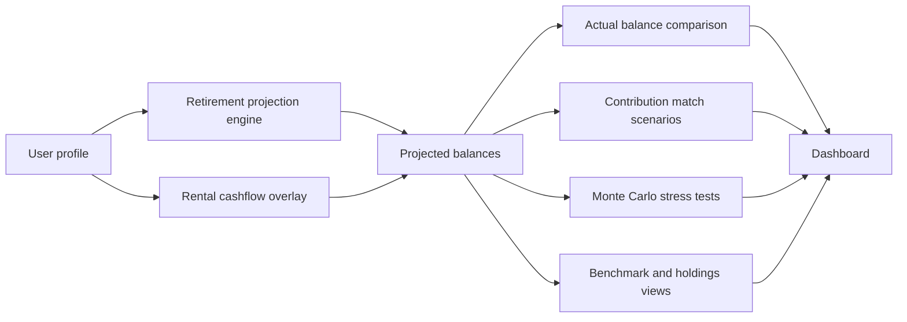

# 💼 Retirement Calculator


Track retirement projections, compare them to real balances, and stress-test the plan with individual and household Monte Carlo scenarios.

This app is built for one practical question: **How is the plan actually holding up over time?**

> This is a local-only copy. It ships with **fictional sample data** in `data/users.json`. Put your own profile in the git-ignored `data/users.local.json` (see [Local profiles](#core-assumptions)).

---

## Why this project exists

Retirement planning usually gets split across spreadsheets, account portals, and one-off calculators. This dashboard brings the main moving parts together:

- **projected vs actual** retirement balances
- **baseline vs contribution-boost** scenarios
- **individual vs household** stress testing
- **long-range planning vs live account context**

---

## What it does

| Feature | What you get |
| --- | --- |
| Retirement projections | Multi-account projection engine for `401k` and `roth_ira` planning |
| Actual balance tracking | Store yearly snapshots and compare them to modeled balances |
| Match scenarios | Overlay `+3%` and `+5%` employee contribution scenarios |
| Monte Carlo stress testing | Run individual and joint household retirement simulations |
| Live holdings | View current-phase holdings data for a user |
| Benchmark comparison | Compare recorded portfolio performance against a Boglehead-style benchmark |
| File vault | Upload and organize retirement, tax, estate, and legal documents |
| Secure access | Basic auth, security headers, and request rate limiting |

---

## Snapshot



---

## Tech stack

- **Backend:** FastAPI
- **Database:** SQLite (default for local use); PostgreSQL is supported through `DATABASE_URL`
- **ORM:** SQLAlchemy
- **Templates:** Jinja2
- **Charts:** Chart.js
- **Rate limiting:** SlowAPI
- **Tests:** Pytest

Key entry points:

- [app/main.py](app/main.py)
- [start_web.ps1](start_web.ps1)

---

## Quick start

### Option 1: easiest path

```powershell
cd retirement-calculator-local
.\start_web.ps1
```

### Option 2: manual setup

Requires [uv](https://docs.astral.sh/uv/) (`winget install --id astral-sh.uv -e`).

```powershell
cd retirement-calculator-local
uv sync
uv run uvicorn app.main:app --reload --port 8000
```

Open:

- `http://localhost:8000/`
- `http://localhost:8000/health`

---

## Environment variables

### Auth

Set these if you want authenticated access. A blank password disables that account.

- `AUTH_STEVEN_PASSWORD`
- `AUTH_ALYSSA_PASSWORD`
- `AUTH_GUEST_PASSWORD`

### Database

- `DATABASE_URL` — optional locally

If `DATABASE_URL` is not set, the app uses local SQLite by default.

### File uploads

- `UPLOAD_DIR` — optional custom storage location for uploaded documents

---

## API surface

### Page + health

- `GET /`
- `GET /files`
- `GET /health`

### Projection endpoints

- `GET /api/comparison/{username}`
- `GET /api/match-scenarios/{username}`
- `GET /api/comparison-all`

### Actual balance endpoints

- `POST /api/balances/{username}`
- `GET /api/balances/{username}`
- `GET /api/balances/record/{balance_id}`
- `PUT /api/balances/{balance_id}`
- `DELETE /api/balances/{balance_id}`

### Stress test endpoints

- `GET /api/stress-test/{username}`
- `POST /api/stress-test/{username}/recalculate`
- `GET /api/stress-test/joint-result?usernames=...`
- `POST /api/stress-test/recalculate-joint`

### Additional data endpoints

- `GET /api/holdings/{username}`
- `GET /api/benchmark/{username}/{year}`

---

## Project layout

```text
retirement-calculator-local/
├─ app/
│  ├─ main.py              # FastAPI app setup
│  ├─ auth.py              # Basic auth and roles
│  ├─ database.py          # engine, sessions, initialization
│  ├─ models.py            # SQLAlchemy models
│  ├─ routes/              # dashboard and API routes
│  ├─ services/            # projections, comparisons, benchmarks, Monte Carlo
│  ├─ static/              # CSS and JavaScript
│  └─ templates/           # Jinja templates
├─ data/                   # sample profile (users.json), uploads, benchmark cache inputs
├─ lib/                    # projection logic and core calculators
├─ tests/                  # pytest coverage
├─ pyproject.toml          # dependencies (uv)
├─ uv.lock                 # locked versions
└─ start_web.ps1
```

---

## Core assumptions

- Baseline planning centers on `401k` and `roth_ira` account paths.
- Match scenarios increase employee `401k` contribution rates by `+3%` and `+5%`.
- Actual balances are stored separately so projections and real snapshots can be compared directly.
- Household stress testing uses shared Monte Carlo logic with correlated shocks.
- The planning view can extend through retirement using withdrawal assumptions.
- Benchmark comparisons use cached market data for repeatable year-based portfolio checks.
- `401k` allocations are dated under `401k_allocation_history` in the configured profile file. Each entry takes effect on its `effective_date` and stays unchanged afterward, so past years keep the mix that applied then. Changes are scheduled through `lib/allocation_history.py` and must be dated today or later. `401k_phases` remains the fallback for legacy profiles and should mirror the latest history entry.
- Roth IRA allocations are dated under `ira_allocation_history` using the same rules. `ira_phases` mirrors the latest entry.
- Deterministic projections, rental overlays, holdings as-of dates, Monte Carlo simulations, benchmark comparisons, and sequence-risk estimates resolve the dated allocation for the relevant year. The current calendar year uses the composition in effect today; other years use the composition effective on January 1.
- Allocation targets and fund selections are user-configurable; projections are estimates, not financial advice.
- 2026 401(k) contribution assumptions: $24,500 deferral, $8,000 age-50+ catch-up, and $11,250 age 60–63 catch-up.
- Local profiles can be stored in the git-ignored `data/users.local.json`, which takes precedence over `data/users.json`. Set `RETIREMENT_USER_DATA_PATH` to an absolute path or a path relative to the project root to select a private profile file explicitly. Profile data is cached for the process lifetime, so restart the app after editing a profile.

---

## Testing

```powershell
cd retirement-calculator-local
uv run pytest -q
```

Install the optional independent financial benchmark, then run only its parity checks:

```powershell
uv sync --extra verification
uv run pytest tests\test_external_benchmark.py -m external_benchmark -q -s
```

The benchmark uses `numpy-financial` to validate 401(k) mid-year and IRA beginning-of-year contribution timing. It validates calculation timing and arithmetic, not projected returns, fund pricing, tax treatment, or IRS limits.

---

## Best for

- tracking retirement progress against a living plan
- comparing actual balances to projected balances over time
- testing contribution increases quickly
- viewing household retirement risk without spreadsheet sprawl
- keeping important planning documents in one place

## Not trying to be

- a full tax-optimization engine
- advisor-grade fiduciary guidance
- a complete model of every retirement variable
- a guarantee of portfolio outcomes or retirement success

---

## In one line

**A focused FastAPI retirement dashboard for projections, actual balance tracking, contribution scenarios, household stress testing, and planning visibility.**
